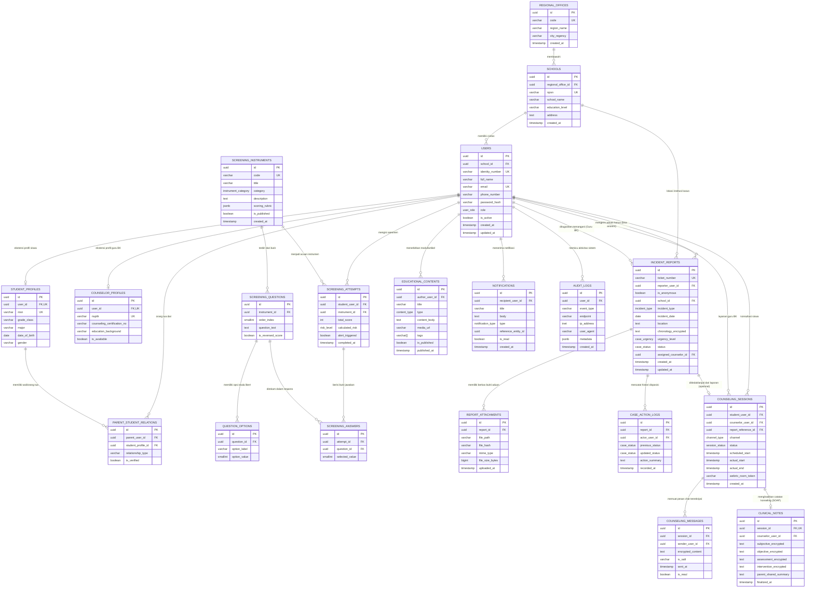

# ENTITY RELATIONSHIP DIAGRAM (ERD) & SPESIFIKASI BASIS DATA
## SISTEM SMART BK CARE (SUMATERA BARAT)
### RDBMS Target: PostgreSQL 15+ (Didukung Ekstensi Pgcrypto & JSONB)

---

## 1. Visualisasi Diagram Relasi Entitas (Mermaid ERD)



---

## 2. Kamus Data Rinci (Data Dictionary)

### 2.1 Klaster Organisasi & Identitas

#### Tabel `REGIONAL_OFFICES` (Cabang Dinas Pendidikan Wilayah Sumbar)
| Nama Kolom | Tipe Data | Constraint | Keterangan |
| :--- | :--- | :--- | :--- |
| `id` | UUID | PRIMARY KEY, DEFAULT gen_random_uuid() | ID unik wilayah dinas |
| `code` | VARCHAR(20) | UNIQUE, NOT NULL | Kode Cabdin (contoh: `CABDIN-WIL1-PDG`) |
| `region_name` | VARCHAR(100) | NOT NULL | Nama kantor wilayah (contoh: Cabdin Wilayah I) |
| `city_regency` | VARCHAR(100) | NOT NULL | Cakupan daerah (contoh: Padang, Pesisir Selatan) |
| `created_at` | TIMESTAMPTZ | NOT NULL, DEFAULT NOW() | Waktu registrasi cabang dinas |

#### Tabel `SCHOOLS` (Sekolah SMA/SMK)
| Nama Kolom | Tipe Data | Constraint | Keterangan |
| :--- | :--- | :--- | :--- |
| `id` | UUID | PRIMARY KEY, DEFAULT gen_random_uuid() | ID unik institusi sekolah |
| `regional_office_id` | UUID | FOREIGN KEY -> REGIONAL_OFFICES(id), ON DELETE RESTRICT | Hubungan ke cabang dinas pembina |
| `npsn` | VARCHAR(16) | UNIQUE, NOT NULL | Nomor Pokok Sekolah Nasional |
| `school_name` | VARCHAR(150) | NOT NULL | Nama resmi satuan pendidikan |
| `education_level` | VARCHAR(10) | NOT NULL | Jenjang: `SMA` atau `SMK` |
| `address` | TEXT | NULLABLE | Alamat lengkap sekolah di Sumbar |
| `created_at` | TIMESTAMPTZ | NOT NULL, DEFAULT NOW() | Waktu pendaftaran sekolah |

#### Tabel `USERS` (Akun Terpadu Seluruh Stakeholder)
| Nama Kolom | Tipe Data | Constraint | Keterangan |
| :--- | :--- | :--- | :--- |
| `id` | UUID | PRIMARY KEY, DEFAULT gen_random_uuid() | ID pengguna global |
| `school_id` | UUID | FOREIGN KEY -> SCHOOLS(id), NULLABLE | Terisi untuk siswa/guru/kepsek, null untuk dinas |
| `identity_number`| VARCHAR(32) | UNIQUE, NOT NULL | NIK / NISN / NUPTK / NIP pegawai |
| `full_name` | VARCHAR(150) | NOT NULL | Nama lengkap pengguna |
| `email` | VARCHAR(100) | UNIQUE, NOT NULL | Alamat email terverifikasi |
| `phone_number` | VARCHAR(20) | NULLABLE | Nomor WhatsApp untuk notifikasi darurat |
| `password_hash` | VARCHAR(255) | NOT NULL | Hash Argon2id / Bcrypt |
| `role` | user_role | NOT NULL | Nilai enum: STUDENT, BK_TEACHER, PRINCIPAL, PARENT, DINAS |
| `is_active` | BOOLEAN | NOT NULL, DEFAULT TRUE | Status keaktifan akun |
| `created_at` | TIMESTAMPTZ | NOT NULL, DEFAULT NOW() | Tanggal pembuatan akun |
| `updated_at` | TIMESTAMPTZ | NOT NULL, DEFAULT NOW() | Tanggal pembaruan profil |

#### Tabel `STUDENT_PROFILES` (Profil Khusus Siswa)
| Nama Kolom | Tipe Data | Constraint | Keterangan |
| :--- | :--- | :--- | :--- |
| `id` | UUID | PRIMARY KEY, DEFAULT gen_random_uuid() | ID profil siswa |
| `user_id` | UUID | UNIQUE, FOREIGN KEY -> USERS(id), ON DELETE CASCADE | Relasi 1-to-1 ke akun pengguna |
| `nisn` | VARCHAR(16) | UNIQUE, NOT NULL | NISN resmi Kemendikbud |
| `grade_class` | VARCHAR(20) | NOT NULL | Kelas (contoh: `X-E1`, `XI-MIPA-2`, `XII-TKJ`) |
| `major` | VARCHAR(50) | NULLABLE | Jurusan/Program keahlian |
| `date_of_birth` | DATE | NOT NULL | Tanggal lahir untuk baseline psikososial |
| `gender` | VARCHAR(10) | NOT NULL | Jenis kelamin (Laki-laki / Perempuan) |

#### Tabel `COUNSELOR_PROFILES` (Profil Khusus Guru BK)
| Nama Kolom | Tipe Data | Constraint | Keterangan |
| :--- | :--- | :--- | :--- |
| `id` | UUID | PRIMARY KEY, DEFAULT gen_random_uuid() | ID profil konselor |
| `user_id` | UUID | UNIQUE, FOREIGN KEY -> USERS(id), ON DELETE CASCADE | Relasi 1-to-1 ke akun pengguna |
| `nuptk` | VARCHAR(24) | UNIQUE, NULLABLE | NUPTK Guru |
| `counseling_certification_no` | VARCHAR(64) | NULLABLE | Nomor sertifikasi konselor/ABKIN |
| `education_background` | VARCHAR(100) | NOT NULL | Latar pendidikan (contoh: S1 Bimbingan & Konseling) |
| `is_available` | BOOLEAN | NOT NULL, DEFAULT TRUE | Ketersediaan sesi konseling daring |

#### Tabel `PARENT_STUDENT_RELATIONS` (Penghubung Orang Tua & Siswa)
| Nama Kolom | Tipe Data | Constraint | Keterangan |
| :--- | :--- | :--- | :--- |
| `id` | UUID | PRIMARY KEY, DEFAULT gen_random_uuid() | ID relasi |
| `parent_user_id` | UUID | FOREIGN KEY -> USERS(id), ON DELETE CASCADE | ID akun orang tua |
| `student_profile_id`| UUID | FOREIGN KEY -> STUDENT_PROFILES(id), ON DELETE CASCADE | ID profil siswa binaan |
| `relationship_type`| VARCHAR(20) | NOT NULL | `AYAH`, `IBU`, atau `WALI` |
| `is_verified` | BOOLEAN | NOT NULL, DEFAULT FALSE | Verifikasi oleh admin sekolah/guru BK |

---

### 2.2 Klaster Deteksi Dini & Instrumen Psikososial

#### Tabel `SCREENING_INSTRUMENTS` (Daftar Skala Penilaian)
| Nama Kolom | Tipe Data | Constraint | Keterangan |
| :--- | :--- | :--- | :--- |
| `id` | UUID | PRIMARY KEY, DEFAULT gen_random_uuid() | ID unik kuesioner |
| `code` | VARCHAR(32) | UNIQUE, NOT NULL | Kode instrumen (contoh: `DASS21-ANX`, `SRQ-20`) |
| `title` | VARCHAR(150) | NOT NULL | Judul kuesioner asesmen |
| `category` | instrument_category | NOT NULL | ANXIETY, STRESS, DEPRESSION, WELL_BEING, BEHAVIORAL_RISK |
| `description` | TEXT | NULLABLE | Panduan pengerjaan bagi siswa |
| `scoring_rubric` | JSONB | NOT NULL | Logika ambang batas skor (*cut-off score*) dan level risiko |
| `is_published` | BOOLEAN | NOT NULL, DEFAULT FALSE | Kesiapan instrumen dipakai |
| `created_at` | TIMESTAMPTZ | NOT NULL, DEFAULT NOW() | Waktu pembuatan instrumen |

#### Tabel `SCREENING_QUESTIONS` (Butir Pertanyaan Skrining)
| Nama Kolom | Tipe Data | Constraint | Keterangan |
| :--- | :--- | :--- | :--- |
| `id` | UUID | PRIMARY KEY, DEFAULT gen_random_uuid() | ID butir pertanyaan |
| `instrument_id` | UUID | FOREIGN KEY -> SCREENING_INSTRUMENTS(id), ON DELETE CASCADE | Pemilik instrumen |
| `order_index` | SMALLINT | NOT NULL | Urutan nomor tampil pada UI Flutter |
| `question_text` | TEXT | NOT NULL | Teks butir pernyataan kuesioner |
| `is_reversed_score`| BOOLEAN | NOT NULL, DEFAULT FALSE | Penanda skoring terbalik (*reverse item*) |

#### Tabel `QUESTION_OPTIONS` (Opsi Skala Likert)
| Nama Kolom | Tipe Data | Constraint | Keterangan |
| :--- | :--- | :--- | :--- |
| `id` | UUID | PRIMARY KEY, DEFAULT gen_random_uuid() | ID opsi |
| `question_id` | UUID | FOREIGN KEY -> SCREENING_QUESTIONS(id), ON DELETE CASCADE | Butir soal terafiliasi |
| `option_label` | VARCHAR(64) | NOT NULL | Contoh: "Tidak Pernah", "Sering" |
| `option_value` | SMALLINT | NOT NULL | Bobot angka (0, 1, 2, 3) |

#### Tabel `SCREENING_ATTEMPTS` (Riwayat Pengerjaan Skrining Siswa)
| Nama Kolom | Tipe Data | Constraint | Keterangan |
| :--- | :--- | :--- | :--- |
| `id` | UUID | PRIMARY KEY, DEFAULT gen_random_uuid() | ID sesi asesmen |
| `student_user_id` | UUID | FOREIGN KEY -> USERS(id), ON DELETE CASCADE | Siswa yang mengerjakan |
| `instrument_id` | UUID | FOREIGN KEY -> SCREENING_INSTRUMENTS(id), ON DELETE RESTRICT | Instrumen yang dipakai |
| `total_score` | INTEGER | NOT NULL | Akumulasi total skor terhitung |
| `calculated_risk` | risk_level | NOT NULL | Hasil kalkulasi: LOW, MODERATE, HIGH, SEVERE |
| `alert_triggered` | BOOLEAN | NOT NULL, DEFAULT FALSE | True jika memicu notifikasi darurat ke guru BK |
| `completed_at` | TIMESTAMPTZ | NOT NULL, DEFAULT NOW() | Waktu submit penyelesaian |

#### Tabel `SCREENING_ANSWERS` (Detail Respons Butir)
| Nama Kolom | Tipe Data | Constraint | Keterangan |
| :--- | :--- | :--- | :--- |
| `id` | UUID | PRIMARY KEY, DEFAULT gen_random_uuid() | ID jawaban butir |
| `attempt_id` | UUID | FOREIGN KEY -> SCREENING_ATTEMPTS(id), ON DELETE CASCADE | Sesi asesmen |
| `question_id` | UUID | FOREIGN KEY -> SCREENING_QUESTIONS(id), ON DELETE RESTRICT | Pertanyaan yang dijawab |
| `selected_value` | SMALLINT | NOT NULL | Nilai bobot jawaban yang dipilih siswa |

---

### 2.3 Klaster Perlindungan & Pengaduan Kasus

#### Tabel `INCIDENT_REPORTS` (Tiket Kasus Bullying / Kekerasan)
| Nama Kolom | Tipe Data | Constraint | Keterangan |
| :--- | :--- | :--- | :--- |
| `id` | UUID | PRIMARY KEY, DEFAULT gen_random_uuid() | ID pengaduan |
| `ticket_number` | VARCHAR(32) | UNIQUE, NOT NULL | Nomor tiket acak (contoh: `BK-REP-202611-0081`) |
| `reporter_user_id`| UUID | FOREIGN KEY -> USERS(id), NULLABLE | ID pelapor (NULL bila murni sistem anonim) |
| `is_anonymous` | BOOLEAN | NOT NULL, DEFAULT FALSE | Menentukan apakah identitas disembunyikan dari guru BK |
| `school_id` | UUID | FOREIGN KEY -> SCHOOLS(id), ON DELETE RESTRICT | Sekolah yurisdiksi kasus |
| `incident_type` | incident_type | NOT NULL | VERBAL_BULLYING, PHYSICAL_BULLYING, CYBER_BULLYING, dll. |
| `incident_date` | DATE | NOT NULL | Tanggal terjadinya peristiwa |
| `location` | TEXT | NOT NULL | Tempat kejadian (di dalam/luar sekolah) |
| `chronology_encrypted`| TEXT | NOT NULL | Kronologi peristiwa (Enkripsi AES-256-GCM) |
| `urgency_level` | case_urgency | NOT NULL, DEFAULT 'MEDIUM' | LOW, MEDIUM, HIGH, CRITICAL |
| `status` | case_status | NOT NULL, DEFAULT 'SUBMITTED' | SUBMITTED, VERIFIED, INVESTIGATION, RESOLVED, dll. |
| `assigned_counselor_id`| UUID | FOREIGN KEY -> USERS(id), NULLABLE | Guru BK penanggung jawab |
| `created_at` | TIMESTAMPTZ | NOT NULL, DEFAULT NOW() | Waktu pembuatan laporan |
| `updated_at` | TIMESTAMPTZ | NOT NULL, DEFAULT NOW() | Waktu pembaruan status |

#### Tabel `REPORT_ATTACHMENTS` (Berkas Bukti Kasus)
| Nama Kolom | Tipe Data | Constraint | Keterangan |
| :--- | :--- | :--- | :--- |
| `id` | UUID | PRIMARY KEY, DEFAULT gen_random_uuid() | ID berkas lampiran |
| `report_id` | UUID | FOREIGN KEY -> INCIDENT_REPORTS(id), ON DELETE CASCADE | Tiket laporan induk |
| `file_path` | VARCHAR(255) | NOT NULL | Jalur penyimpanan di S3 / MinIO terenkripsi |
| `file_hash` | VARCHAR(64) | NOT NULL | SHA-256 untuk menjaga integritas keaslian barang bukti |
| `mime_type` | VARCHAR(64) | NOT NULL | image/jpeg, image/png, video/mp4, application/pdf |
| `file_size_bytes`| BIGINT | NOT NULL | Ukuran berkas dalam byte |
| `uploaded_at` | TIMESTAMPTZ | NOT NULL, DEFAULT NOW() | Waktu unggah berkas |

#### Tabel `CASE_ACTION_LOGS` (Histori Penanganan Kasus)
| Nama Kolom | Tipe Data | Constraint | Keterangan |
| :--- | :--- | :--- | :--- |
| `id` | UUID | PRIMARY KEY, DEFAULT gen_random_uuid() | ID log tindakan |
| `report_id` | UUID | FOREIGN KEY -> INCIDENT_REPORTS(id), ON DELETE CASCADE | Laporan yang ditindak |
| `actor_user_id` | UUID | FOREIGN KEY -> USERS(id), ON DELETE RESTRICT | Guru BK / Tim TPPK yang mengubah status |
| `previous_status`| case_status | NOT NULL | Status laporan sebelum diperbarui |
| `updated_status` | case_status | NOT NULL | Status laporan sesudah diperbarui |
| `action_summary` | TEXT | NOT NULL | Catatan deskripsi tindakan yang telah diambil |
| `recorded_at` | TIMESTAMPTZ | NOT NULL, DEFAULT NOW() | Waktu pencatatan tindakan |

---

### 2.4 Klaster Layanan Konseling Digital & Catatan Kasus

#### Tabel `COUNSELING_SESSIONS` (Sesi Konsultasi Daring & Tatap Muka)
| Nama Kolom | Tipe Data | Constraint | Keterangan |
| :--- | :--- | :--- | :--- |
| `id` | UUID | PRIMARY KEY, DEFAULT gen_random_uuid() | ID sesi konseling |
| `student_user_id` | UUID | FOREIGN KEY -> USERS(id), ON DELETE RESTRICT | Siswa konseli |
| `counselor_user_id`| UUID | FOREIGN KEY -> USERS(id), ON DELETE RESTRICT | Guru BK pembimbing |
| `report_reference_id`| UUID | FOREIGN KEY -> INCIDENT_REPORTS(id), NULLABLE | Tautan ke laporan jika sesi berawal dari kasus |
| `channel` | channel_type | NOT NULL | CHAT, VOICE, VIDEO, IN_PERSON |
| `status` | session_status | NOT NULL, DEFAULT 'PENDING' | PENDING, CONFIRMED, ACTIVE, COMPLETED, CANCELLED |
| `scheduled_start`| TIMESTAMPTZ | NOT NULL | Waktu mulai sesi yang disepakati |
| `actual_start` | TIMESTAMPTZ | NULLABLE | Waktu riil WebRTC / chat dimulai |
| `actual_end` | TIMESTAMPTZ | NULLABLE | Waktu riil sesi diakhiri |
| `webrtc_room_token`| VARCHAR(255) | NULLABLE | Token room LiveKit / SFU terproteksi |
| `created_at` | TIMESTAMPTZ | NOT NULL, DEFAULT NOW() | Waktu pengajuan jadwal konseling |

#### Tabel `COUNSELING_MESSAGES` (Pesan Konseling Realtime E2EE)
| Nama Kolom | Tipe Data | Constraint | Keterangan |
| :--- | :--- | :--- | :--- |
| `id` | UUID | PRIMARY KEY, DEFAULT gen_random_uuid() | ID pesan chat |
| `session_id` | UUID | FOREIGN KEY -> COUNSELING_SESSIONS(id), ON DELETE CASCADE | Sesi konseling aktif |
| `sender_user_id` | UUID | FOREIGN KEY -> USERS(id), ON DELETE RESTRICT | Pengirim pesan (Siswa atau Guru BK) |
| `encrypted_content`| TEXT | NOT NULL | Pesan terenkripsi (AES-256) |
| `iv_salt` | VARCHAR(64) | NOT NULL | Initialization Vector unik per pesan |
| `sent_at` | TIMESTAMPTZ | NOT NULL, DEFAULT NOW() | Waktu pesan dikirimkan |
| `is_read` | BOOLEAN | NOT NULL, DEFAULT FALSE | Status pesan sudah dibaca konseli/konselor |

#### Tabel `CLINICAL_NOTES` (Catatan Konseling Rahasia / SOAP)
| Nama Kolom | Tipe Data | Constraint | Keterangan |
| :--- | :--- | :--- | :--- |
| `id` | UUID | PRIMARY KEY, DEFAULT gen_random_uuid() | ID rekam konseling |
| `session_id` | UUID | UNIQUE, FOREIGN KEY -> COUNSELING_SESSIONS(id), ON DELETE CASCADE | Terikat pada 1 sesi konseling |
| `counselor_user_id`| UUID | FOREIGN KEY -> USERS(id), ON DELETE RESTRICT | Guru BK pembuat catatan |
| `subjective_encrypted`| TEXT | NOT NULL | Deskripsi subjektif keluhan siswa (Terenkripsi) |
| `objective_encrypted` | TEXT | NOT NULL | Observasi perilaku / gestur siswa (Terenkripsi) |
| `assessment_encrypted` | TEXT | NOT NULL | Analisis bimbingan dan dinamika masalah (Terenkripsi) |
| `intervention_encrypted`| TEXT | NOT NULL | Rencana intervensi & tindak lanjut (Terenkripsi) |
| `parent_shared_summary`| TEXT | NULLABLE | Resume yang diizinkan dibagikan ke orang tua |
| `finalized_at` | TIMESTAMPTZ | NOT NULL, DEFAULT NOW() | Waktu penutupan catatan konseling |

---

### 2.5 Klaster Edukasi, Notifikasi & Audit Keamanan

#### Tabel `EDUCATIONAL_CONTENTS` (Artikel, Video, & Modul Kesehatan Mental)
| Nama Kolom | Tipe Data | Constraint | Keterangan |
| :--- | :--- | :--- | :--- |
| `id` | UUID | PRIMARY KEY, DEFAULT gen_random_uuid() | ID materi edukasi |
| `author_user_id` | UUID | FOREIGN KEY -> USERS(id), ON DELETE RESTRICT | Guru BK atau dinas pembuat konten |
| `title` | VARCHAR(200) | NOT NULL | Judul materi literasi |
| `type` | content_type | NOT NULL | ARTICLE, INFOGRAPHIC, VIDEO, PODCAST_AUDIO, MODULE_PDF |
| `content_body` | TEXT | NULLABLE | Teks materi format Markdown |
| `media_url` | VARCHAR(255) | NULLABLE | Tautan video/audio streaming atau dokumen PDF |
| `tags` | VARCHAR(32)[] | NULLABLE | Tag tematik (contoh: `['stress', 'ujian', 'karir']`) |
| `is_published` | BOOLEAN | NOT NULL, DEFAULT TRUE | Status tayang konten |
| `published_at` | TIMESTAMPTZ | NOT NULL, DEFAULT NOW() | Waktu penerbitan |

#### Tabel `NOTIFICATIONS` (Pemberitahuan Sistem & Alert)
| Nama Kolom | Tipe Data | Constraint | Keterangan |
| :--- | :--- | :--- | :--- |
| `id` | UUID | PRIMARY KEY, DEFAULT gen_random_uuid() | ID notifikasi |
| `recipient_user_id`| UUID | FOREIGN KEY -> USERS(id), ON DELETE CASCADE | Penerima notifikasi |
| `title` | VARCHAR(100) | NOT NULL | Judul pemberitahuan |
| `body` | TEXT | NOT NULL | Isi ringkas pemberitahuan |
| `type` | notification_type | NOT NULL | SCREENING_ALERT, CASE_UPDATE, SESSION_REMINDER, SYSTEM_INFO |
| `reference_entity_id`| UUID | NULLABLE | ID acuan ke tiket kasus atau sesi konseling |
| `is_read` | BOOLEAN | NOT NULL, DEFAULT FALSE | Status dibaca pada aplikasi Flutter |
| `created_at` | TIMESTAMPTZ | NOT NULL, DEFAULT NOW() | Waktu notifikasi dibuat |

#### Tabel `AUDIT_LOGS` (Jejak Rekam Keamanan & Kepatuhan UU PDP)
| Nama Kolom | Tipe Data | Constraint | Keterangan |
| :--- | :--- | :--- | :--- |
| `id` | UUID | PRIMARY KEY, DEFAULT gen_random_uuid() | ID catatan audit |
| `user_id` | UUID | FOREIGN KEY -> USERS(id), NULLABLE | Aktor (NULL jika aksi sebelum login/publik) |
| `event_type` | VARCHAR(64) | NOT NULL | Contoh: `VIEW_CONFIDENTIAL_NOTE`, `EXPORT_REPORT` |
| `endpoint` | VARCHAR(255) | NOT NULL | Rute API yang diakses |
| `ip_address` | INET | NOT NULL | Alamat IP klien pengakses |
| `user_agent` | VARCHAR(255) | NOT NULL | Informasi aplikasi klien/perangkat mobile |
| `metadata` | JSONB | NULLABLE | Rincian data perubahan (lama vs baru) |
| `created_at` | TIMESTAMPTZ | NOT NULL, DEFAULT NOW() | Waktu kejadian mutlak (*immutable*) |

---

## 3. Skrip DDL PostgreSQL Lengkap (Siap Eksekusi)

```sql
-- ============================================================================
-- SMART BK CARE - SKEMA BASIS DATA POSTGRESQL LENGKAP
-- Wilayah Implementasi: SMA / SMK Sumatera Barat
-- ============================================================================

-- 1. Ekstensi Kriptografi & UUID
CREATE EXTENSION IF NOT EXISTS "uuid-ossp";
CREATE EXTENSION IF NOT EXISTS "pgcrypto";

-- 2. Definisi Tipe ENUM
CREATE TYPE user_role AS ENUM (
    'STUDENT', 
    'BK_TEACHER', 
    'PRINCIPAL', 
    'PARENT', 
    'DINAS'
);

CREATE TYPE risk_level AS ENUM (
    'LOW', 
    'MODERATE', 
    'HIGH', 
    'SEVERE'
);

CREATE TYPE instrument_category AS ENUM (
    'ANXIETY', 
    'STRESS', 
    'DEPRESSION', 
    'WELL_BEING', 
    'BEHAVIORAL_RISK'
);

CREATE TYPE incident_type AS ENUM (
    'VERBAL_BULLYING', 
    'PHYSICAL_BULLYING', 
    'CYBER_BULLYING', 
    'SEXUAL_HARASSMENT', 
    'EXTORTION', 
    'OTHER'
);

CREATE TYPE case_urgency AS ENUM (
    'LOW', 
    'MEDIUM', 
    'HIGH', 
    'CRITICAL'
);

CREATE TYPE case_status AS ENUM (
    'SUBMITTED', 
    'VERIFIED', 
    'INVESTIGATION', 
    'IN_COUNSELING', 
    'ESCALATED_DINAS', 
    'RESOLVED', 
    'DISMISSED'
);

CREATE TYPE channel_type AS ENUM (
    'CHAT', 
    'VOICE', 
    'VIDEO', 
    'IN_PERSON'
);

CREATE TYPE session_status AS ENUM (
    'PENDING', 
    'CONFIRMED', 
    'ACTIVE', 
    'COMPLETED', 
    'CANCELLED', 
    'NO_SHOW'
);

CREATE TYPE content_type AS ENUM (
    'ARTICLE', 
    'INFOGRAPHIC', 
    'VIDEO', 
    'PODCAST_AUDIO', 
    'MODULE_PDF'
);

CREATE TYPE notification_type AS ENUM (
    'SCREENING_ALERT', 
    'CASE_UPDATE', 
    'SESSION_REMINDER', 
    'SYSTEM_INFO'
);

-- ============================================================================
-- 3. Pembuatan Tabel Master Institusi & Akun
-- ============================================================================

CREATE TABLE regional_offices (
    id UUID PRIMARY KEY DEFAULT gen_random_uuid(),
    code VARCHAR(20) UNIQUE NOT NULL,
    region_name VARCHAR(100) NOT NULL,
    city_regency VARCHAR(100) NOT NULL,
    created_at TIMESTAMPTZ NOT NULL DEFAULT NOW()
);

CREATE TABLE schools (
    id UUID PRIMARY KEY DEFAULT gen_random_uuid(),
    regional_office_id UUID NOT NULL REFERENCES regional_offices(id) ON DELETE RESTRICT,
    npsn VARCHAR(16) UNIQUE NOT NULL,
    school_name VARCHAR(150) NOT NULL,
    education_level VARCHAR(10) NOT NULL CHECK (education_level IN ('SMA', 'SMK')),
    address TEXT,
    created_at TIMESTAMPTZ NOT NULL DEFAULT NOW()
);

CREATE TABLE users (
    id UUID PRIMARY KEY DEFAULT gen_random_uuid(),
    school_id UUID REFERENCES schools(id) ON DELETE SET NULL,
    identity_number VARCHAR(32) UNIQUE NOT NULL,
    full_name VARCHAR(150) NOT NULL,
    email VARCHAR(100) UNIQUE NOT NULL,
    phone_number VARCHAR(20),
    password_hash VARCHAR(255) NOT NULL,
    role user_role NOT NULL,
    is_active BOOLEAN NOT NULL DEFAULT TRUE,
    created_at TIMESTAMPTZ NOT NULL DEFAULT NOW(),
    updated_at TIMESTAMPTZ NOT NULL DEFAULT NOW()
);

CREATE TABLE student_profiles (
    id UUID PRIMARY KEY DEFAULT gen_random_uuid(),
    user_id UUID UNIQUE NOT NULL REFERENCES users(id) ON DELETE CASCADE,
    nisn VARCHAR(16) UNIQUE NOT NULL,
    grade_class VARCHAR(20) NOT NULL,
    major VARCHAR(50),
    date_of_birth DATE NOT NULL,
    gender VARCHAR(10) NOT NULL CHECK (gender IN ('Laki-laki', 'Perempuan'))
);

CREATE TABLE counselor_profiles (
    id UUID PRIMARY KEY DEFAULT gen_random_uuid(),
    user_id UUID UNIQUE NOT NULL REFERENCES users(id) ON DELETE CASCADE,
    nuptk VARCHAR(24) UNIQUE,
    counseling_certification_no VARCHAR(64),
    education_background VARCHAR(100) NOT NULL,
    is_available BOOLEAN NOT NULL DEFAULT TRUE
);

CREATE TABLE parent_student_relations (
    id UUID PRIMARY KEY DEFAULT gen_random_uuid(),
    parent_user_id UUID NOT NULL REFERENCES users(id) ON DELETE CASCADE,
    student_profile_id UUID NOT NULL REFERENCES student_profiles(id) ON DELETE CASCADE,
    relationship_type VARCHAR(20) NOT NULL CHECK (relationship_type IN ('AYAH', 'IBU', 'WALI')),
    is_verified BOOLEAN NOT NULL DEFAULT FALSE,
    CONSTRAINT unique_parent_student_pair UNIQUE (parent_user_id, student_profile_id)
);

-- ============================================================================
-- 4. Pembuatan Tabel Deteksi Dini & Instrumen Psikososial
-- ============================================================================

CREATE TABLE screening_instruments (
    id UUID PRIMARY KEY DEFAULT gen_random_uuid(),
    code VARCHAR(32) UNIQUE NOT NULL,
    title VARCHAR(150) NOT NULL,
    category instrument_category NOT NULL,
    description TEXT,
    scoring_rubric JSONB NOT NULL,
    is_published BOOLEAN NOT NULL DEFAULT FALSE,
    created_at TIMESTAMPTZ NOT NULL DEFAULT NOW()
);

CREATE TABLE screening_questions (
    id UUID PRIMARY KEY DEFAULT gen_random_uuid(),
    instrument_id UUID NOT NULL REFERENCES screening_instruments(id) ON DELETE CASCADE,
    order_index SMALLINT NOT NULL,
    question_text TEXT NOT NULL,
    is_reversed_score BOOLEAN NOT NULL DEFAULT FALSE,
    CONSTRAINT unique_instrument_question_order UNIQUE (instrument_id, order_index)
);

CREATE TABLE question_options (
    id UUID PRIMARY KEY DEFAULT gen_random_uuid(),
    question_id UUID NOT NULL REFERENCES screening_questions(id) ON DELETE CASCADE,
    option_label VARCHAR(64) NOT NULL,
    option_value SMALLINT NOT NULL
);

CREATE TABLE screening_attempts (
    id UUID PRIMARY KEY DEFAULT gen_random_uuid(),
    student_user_id UUID NOT NULL REFERENCES users(id) ON DELETE CASCADE,
    instrument_id UUID NOT NULL REFERENCES screening_instruments(id) ON DELETE RESTRICT,
    total_score INTEGER NOT NULL,
    calculated_risk risk_level NOT NULL,
    alert_triggered BOOLEAN NOT NULL DEFAULT FALSE,
    completed_at TIMESTAMPTZ NOT NULL DEFAULT NOW()
);

CREATE TABLE screening_answers (
    id UUID PRIMARY KEY DEFAULT gen_random_uuid(),
    attempt_id UUID NOT NULL REFERENCES screening_attempts(id) ON DELETE CASCADE,
    question_id UUID NOT NULL REFERENCES screening_questions(id) ON DELETE RESTRICT,
    selected_value SMALLINT NOT NULL,
    CONSTRAINT unique_attempt_question UNIQUE (attempt_id, question_id)
);

-- ============================================================================
-- 5. Pembuatan Tabel Perlindungan & Penanganan Kasus
-- ============================================================================

CREATE TABLE incident_reports (
    id UUID PRIMARY KEY DEFAULT gen_random_uuid(),
    ticket_number VARCHAR(32) UNIQUE NOT NULL,
    reporter_user_id UUID REFERENCES users(id) ON DELETE SET NULL,
    is_anonymous BOOLEAN NOT NULL DEFAULT FALSE,
    school_id UUID NOT NULL REFERENCES schools(id) ON DELETE RESTRICT,
    incident_type incident_type NOT NULL,
    incident_date DATE NOT NULL,
    location TEXT NOT NULL,
    chronology_encrypted TEXT NOT NULL,
    urgency_level case_urgency NOT NULL DEFAULT 'MEDIUM',
    status case_status NOT NULL DEFAULT 'SUBMITTED',
    assigned_counselor_id UUID REFERENCES users(id) ON DELETE SET NULL,
    created_at TIMESTAMPTZ NOT NULL DEFAULT NOW(),
    updated_at TIMESTAMPTZ NOT NULL DEFAULT NOW()
);

CREATE TABLE report_attachments (
    id UUID PRIMARY KEY DEFAULT gen_random_uuid(),
    report_id UUID NOT NULL REFERENCES incident_reports(id) ON DELETE CASCADE,
    file_path VARCHAR(255) NOT NULL,
    file_hash VARCHAR(64) NOT NULL,
    mime_type VARCHAR(64) NOT NULL,
    file_size_bytes BIGINT NOT NULL,
    uploaded_at TIMESTAMPTZ NOT NULL DEFAULT NOW()
);

CREATE TABLE case_action_logs (
    id UUID PRIMARY KEY DEFAULT gen_random_uuid(),
    report_id UUID NOT NULL REFERENCES incident_reports(id) ON DELETE CASCADE,
    actor_user_id UUID NOT NULL REFERENCES users(id) ON DELETE RESTRICT,
    previous_status case_status NOT NULL,
    updated_status case_status NOT NULL,
    action_summary TEXT NOT NULL,
    recorded_at TIMESTAMPTZ NOT NULL DEFAULT NOW()
);

-- ============================================================================
-- 6. Pembuatan Tabel Konseling Digital & Rekam Konseling
-- ============================================================================

CREATE TABLE counseling_sessions (
    id UUID PRIMARY KEY DEFAULT gen_random_uuid(),
    student_user_id UUID NOT NULL REFERENCES users(id) ON DELETE RESTRICT,
    counselor_user_id UUID NOT NULL REFERENCES users(id) ON DELETE RESTRICT,
    report_reference_id UUID REFERENCES incident_reports(id) ON DELETE SET NULL,
    channel channel_type NOT NULL,
    status session_status NOT NULL DEFAULT 'PENDING',
    scheduled_start TIMESTAMPTZ NOT NULL,
    actual_start TIMESTAMPTZ,
    actual_end TIMESTAMPTZ,
    webrtc_room_token VARCHAR(255),
    created_at TIMESTAMPTZ NOT NULL DEFAULT NOW()
);

CREATE TABLE counseling_messages (
    id UUID PRIMARY KEY DEFAULT gen_random_uuid(),
    session_id UUID NOT NULL REFERENCES counseling_sessions(id) ON DELETE CASCADE,
    sender_user_id UUID NOT NULL REFERENCES users(id) ON DELETE RESTRICT,
    encrypted_content TEXT NOT NULL,
    iv_salt VARCHAR(64) NOT NULL,
    sent_at TIMESTAMPTZ NOT NULL DEFAULT NOW(),
    is_read BOOLEAN NOT NULL DEFAULT FALSE
);

CREATE TABLE clinical_notes (
    id UUID PRIMARY KEY DEFAULT gen_random_uuid(),
    session_id UUID UNIQUE NOT NULL REFERENCES counseling_sessions(id) ON DELETE CASCADE,
    counselor_user_id UUID NOT NULL REFERENCES users(id) ON DELETE RESTRICT,
    subjective_encrypted TEXT NOT NULL,
    objective_encrypted TEXT NOT NULL,
    assessment_encrypted TEXT NOT NULL,
    intervention_encrypted TEXT NOT NULL,
    parent_shared_summary TEXT,
    finalized_at TIMESTAMPTZ NOT NULL DEFAULT NOW()
);

-- ============================================================================
-- 7. Pembuatan Tabel Edukasi, Notifikasi & Audit Log
-- ============================================================================

CREATE TABLE educational_contents (
    id UUID PRIMARY KEY DEFAULT gen_random_uuid(),
    author_user_id UUID NOT NULL REFERENCES users(id) ON DELETE RESTRICT,
    title VARCHAR(200) NOT NULL,
    type content_type NOT NULL,
    content_body TEXT,
    media_url VARCHAR(255),
    tags VARCHAR(32)[],
    is_published BOOLEAN NOT NULL DEFAULT TRUE,
    published_at TIMESTAMPTZ NOT NULL DEFAULT NOW()
);

CREATE TABLE notifications (
    id UUID PRIMARY KEY DEFAULT gen_random_uuid(),
    recipient_user_id UUID NOT NULL REFERENCES users(id) ON DELETE CASCADE,
    title VARCHAR(100) NOT NULL,
    body TEXT NOT NULL,
    type notification_type NOT NULL,
    reference_entity_id UUID,
    is_read BOOLEAN NOT NULL DEFAULT FALSE,
    created_at TIMESTAMPTZ NOT NULL DEFAULT NOW()
);

CREATE TABLE audit_logs (
    id UUID PRIMARY KEY DEFAULT gen_random_uuid(),
    user_id UUID REFERENCES users(id) ON DELETE SET NULL,
    event_type VARCHAR(64) NOT NULL,
    endpoint VARCHAR(255) NOT NULL,
    ip_address INET NOT NULL,
    user_agent VARCHAR(255) NOT NULL,
    metadata JSONB,
    created_at TIMESTAMPTZ NOT NULL DEFAULT NOW()
);

-- ============================================================================
-- 8. Indeks Kinerja & Optimasi Query
-- ============================================================================

-- Pencarian Pengguna & Hak Akses
CREATE INDEX idx_users_school_role ON users(school_id, role);
CREATE INDEX idx_users_email ON users(email);

-- Pencarian Riwayat Skrining & Triase Darurat
CREATE INDEX idx_screening_attempts_student ON screening_attempts(student_user_id, completed_at DESC);
CREATE INDEX idx_screening_attempts_risk ON screening_attempts(calculated_risk) WHERE calculated_risk IN ('HIGH', 'SEVERE');

-- Monitoring & Dasbor Tiket Kasus Sekolah
CREATE INDEX idx_reports_school_status ON incident_reports(school_id, status);
CREATE INDEX idx_reports_urgency ON incident_reports(urgency_level) WHERE urgency_level IN ('HIGH', 'CRITICAL');
CREATE INDEX idx_reports_assigned_counselor ON incident_reports(assigned_counselor_id);

-- Pesan Chat & Sesi Konseling Realtime
CREATE INDEX idx_counseling_sessions_participants ON counseling_sessions(student_user_id, counselor_user_id, status);
CREATE INDEX idx_counseling_messages_session ON counseling_messages(session_id, sent_at ASC);

-- Notifikasi Cepat Per Pengguna
CREATE INDEX idx_notifications_recipient_unread ON notifications(recipient_user_id, is_read) WHERE is_read = FALSE;

-- Penelusuran Log Audit Kepatuhan Keamanan
CREATE INDEX idx_audit_logs_event_time ON audit_logs(event_type, created_at DESC);
```

---

## 4. Analisis Hubungan Kardinalitas dan Integritas Data

1. **`USERS` ke `STUDENT_PROFILES` / `COUNSELOR_PROFILES` ($1 : 1$)**:
   * Menggunakan pola *Table Inheritance by Composition*. Entitas `USERS` menyimpan kredensial login, sedangkan data spesifik sekolah dan konseling dipisahkan dengan *foreign key* yang memiliki konstrain `UNIQUE`.
2. **`USERS` (Parent) ke `STUDENT_PROFILES` ($N : M$ via `PARENT_STUDENT_RELATIONS`)**:
   * Satu orang tua dapat memantau lebih dari satu anak (misal kakak-beradik di jenjang SMA/SMK), dan satu siswa dapat dihubungkan ke ayah, ibu, atau wali dengan status verifikasi (`is_verified`).
3. **`INCIDENT_REPORTS` ke `USERS` (Pelapor & Konselor)**:
   * Kolom `reporter_user_id` bersifat *nullable* untuk mengakomodasi pelaporan 100% anonim (*whistleblowing*), sementara `assigned_counselor_id` menunjuk langsung guru BK yang bertanggung jawab melakukan investigasi dan tindak lanjut kasus.
4. **`COUNSELING_SESSIONS` ke `CLINICAL_NOTES` ($1 : 1$)**:
   * Setiap sesi konseling menghasilkan tepat satu rekam catatan kasus (*clinical note*) berformat SOAP (*Subjective, Objective, Assessment, Plan*) yang field sensitifnya dienkripsi sebelum masuk ke database.